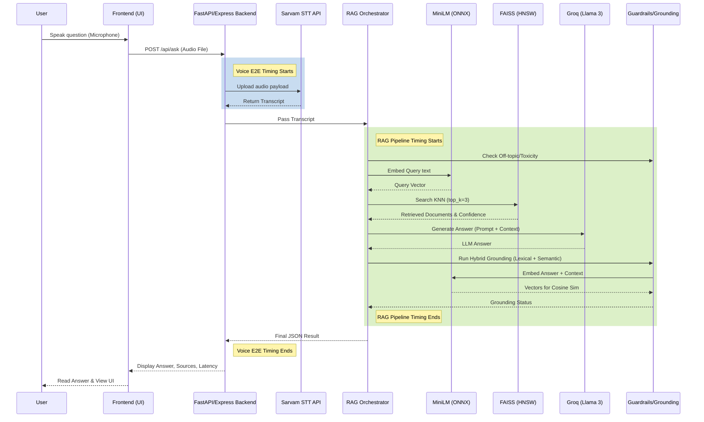

# System Architecture

This document describes the high-level data flow and architecture of the Voice-Enabled RAG System.

## High-Level Data Flow

## Latency Instrumentation Points

Latency is measured using high-resolution monotonic timers (`performance.now()`) to track exact segment durations without network fluctuation skew:

1. **Voice E2E Latency**: Tracks the full duration starting from the moment the backend receives the uploaded file, until the final JSON is dispatched to the frontend. This includes all STT network handshakes.
2. **RAG Pipeline Latency**: Tracks the isolated time spent processing text, retrieving, generating, and grounding. It completely excludes the initial STT network round-trip.
3. **Micro-Timers**: Track exact internal segments:
   - `query_processing`
   - `embedding`
   - `vector_retrieval`
   - `context_construction`
   - `llm_generation`
   - `grounding`
   - `other` (event loop overhead)
