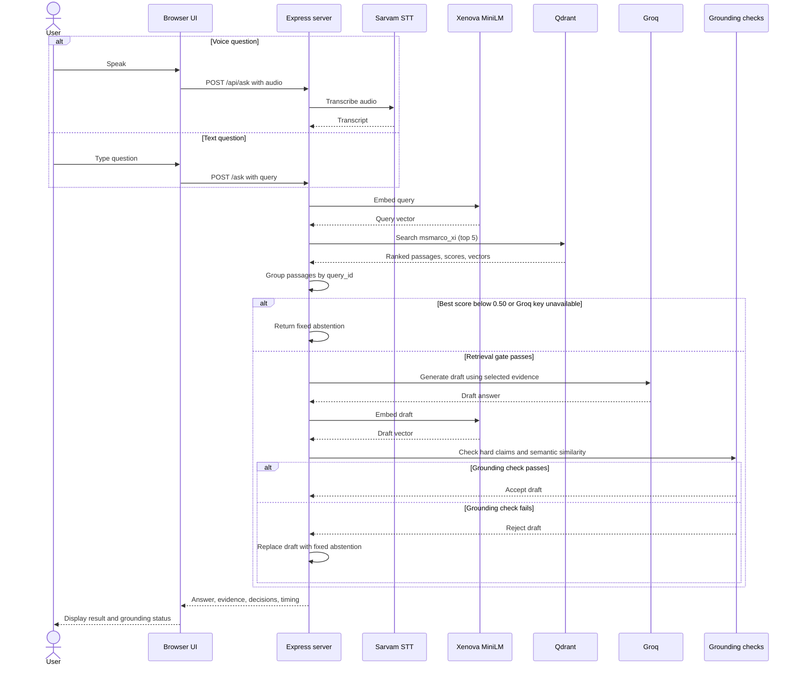

# System Architecture

This diagram follows the current Express request path. Qdrant is selected with `QDRANT_URL`; the service may be local Docker or Qdrant Cloud.

## Request and answer flow

The retrieval gate and grounding check are safeguards, not proof of correctness. A rejected draft is replaced before it is returned to the browser. The unsafe-query helper currently in `guardrails.js` is not wired into these request routes.

## Grounding decision

- Retrieval is skipped when the best Qdrant score is below `0.50`.
- Grounding checks a draft only after the LLM is called.
- The lexical check rejects capitalized names and numbers absent from retrieved evidence.
- The semantic check compares the answer embedding with retrieved passage embeddings and accepts a maximum cosine similarity of at least `0.80`.
- If either check rejects the answer, the API returns a fixed abstention and reports the grounding method and result.

These thresholds are configurable in code and have not been validated as universal accuracy thresholds.

## Timing fields

The API reports request timings measured with `performance.now()`:

- Text and voice RAG: `queryProcessingMs`, `embeddingMs`, `retrievalMs`, `groupingMs`, `evidenceMs`, `llmMs`, `answerEmbeddingMs`, `groundingMs`, `groundingLexicalMs`, `groundingSemanticMs`, and `ragTotalMs`.
- Voice requests also report `sttMs` and `voiceTotalMs`.

RAG timing excludes speech transcription. Timings vary with model warm-up, network conditions, and external services; historical benchmark numbers are not latency guarantees.
